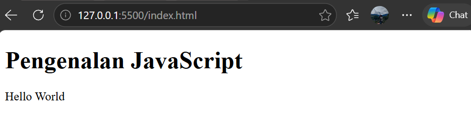
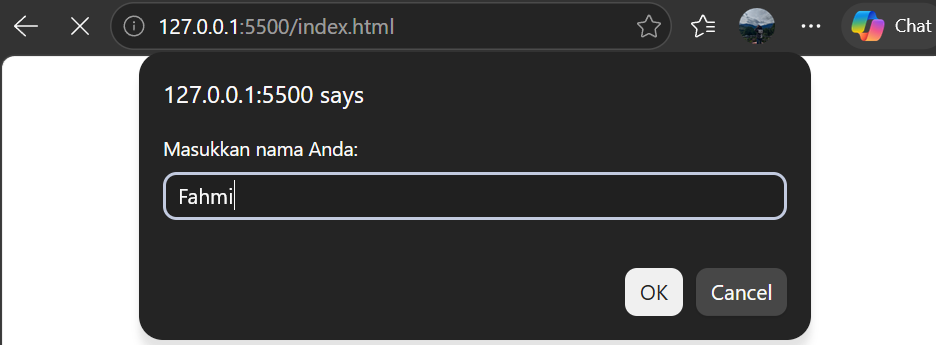
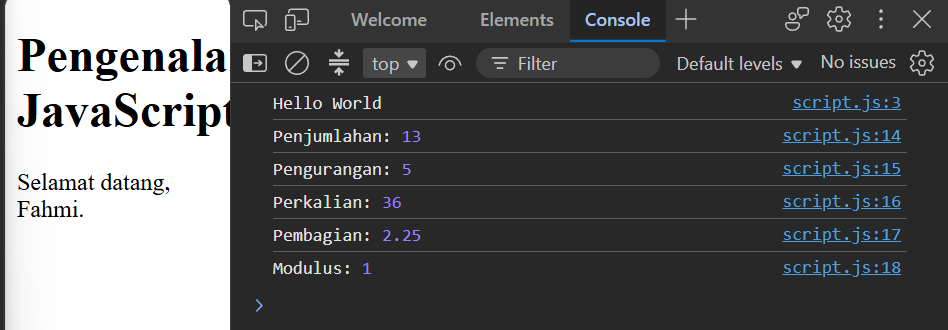
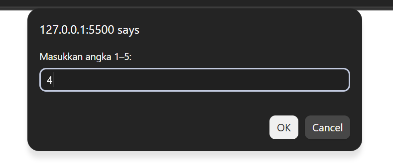
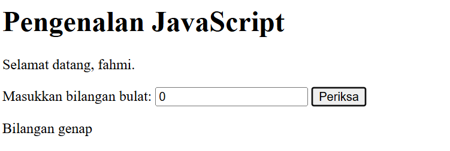
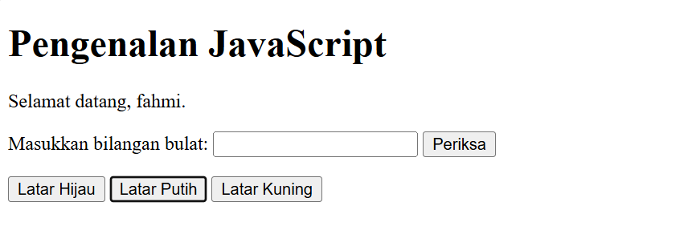
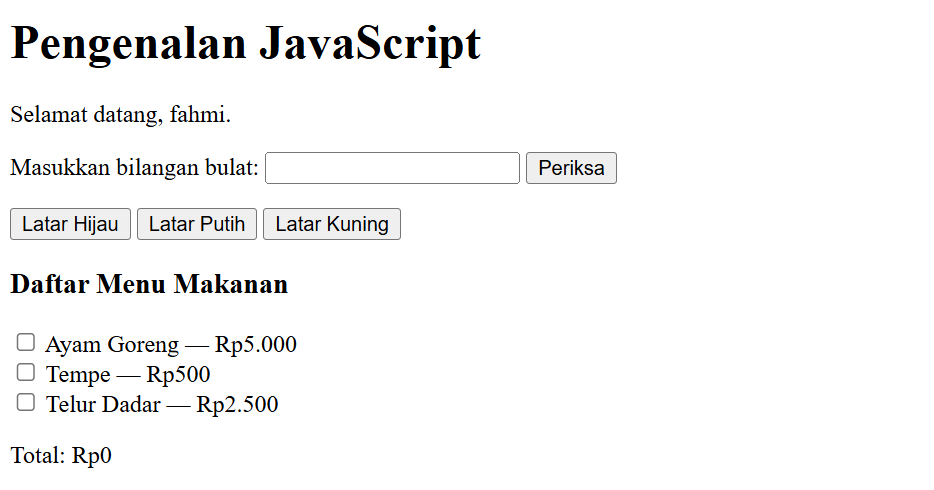
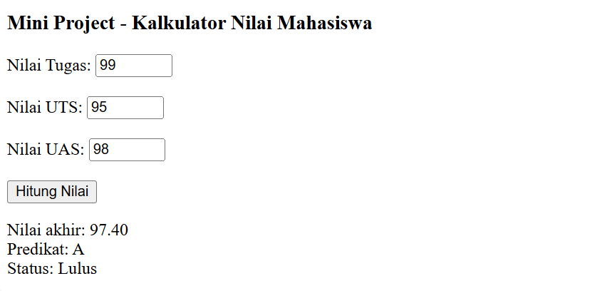
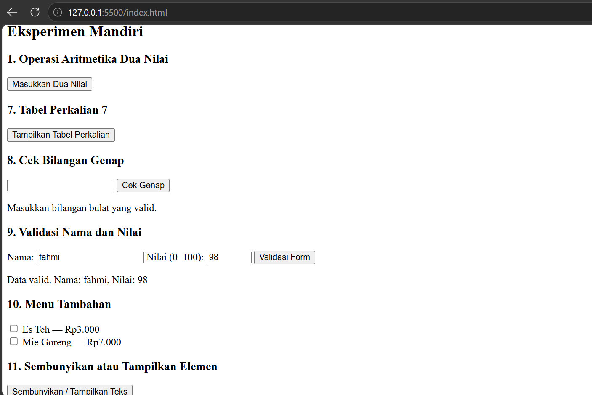

# Praktikum 5: JavaScript Dasar dan Manipulasi HTML

**Nama:** M. Fahmi Abdul B.  
**NIM:** 312510260  
**Program Studi:** Teknik Informatika  
**Universitas:** Universitas Pelita Bangsa

---

## A. Tujuan Praktikum

Praktikum ini bertujuan untuk:

1. Memahami sintaks dasar JavaScript dan cara menyisipkan JavaScript pada HTML.
2. Menggunakan variabel, tipe data, operator, percabangan, perulangan, dan function.
3. Menampilkan informasi melalui `console.log()`, `alert()`, `prompt()`, dan elemen HTML.
4. Memanipulasi konten serta gaya elemen HTML menggunakan JavaScript.
5. Membuat interaksi sederhana pada form dan melakukan validasi input.
6. Mendokumentasikan pekerjaan praktikum beserta hasil pengujiannya.

## B. Perangkat Praktikum

Perangkat yang digunakan:

- Laptop atau PC.
- Visual Studio Code sebagai editor kode.
- Browser modern, seperti Google Chrome.
- File HTML dan JavaScript.
- Repository GitHub untuk menyimpan hasil praktikum.


## C. Persiapan Praktikum

### Langkah 1 — Membuat file HTML

Buat file `index.html` di Visual Studio Code.

Kode dasar HTML:

```html
<!DOCTYPE html>
<html lang="id">
<head>
    <meta charset="UTF-8">
    <meta name="viewport" content="width=device-width, initial-scale=1.0">
    <title>Praktikum 5 - JavaScript</title>
</head>
<body>
    <h1>Pengenalan JavaScript</h1>
    <p id="pesan">Konten awal.</p>

    <script src="script.js"></script>
</body>
</html>
```

### Langkah 2 — Membuat file JavaScript

Buat file `script.js` pada folder yang sama dengan `index.html`.

JavaScript digunakan untuk mengatur perilaku halaman web, melakukan perhitungan, menampilkan pesan, dan memanipulasi elemen HTML.

### Langkah 3 — Menjalankan program

1. Simpan file HTML dan JavaScript.
2. Buka `index.html` menggunakan browser.
3. Tekan `F12` atau klik kanan halaman, lalu pilih **Inspect**.
4. Pilih tab **Console** untuk melihat hasil `console.log()`.
5. Jalankan dan uji setiap latihan sesuai langkah kerja.

---

## D. Langkah Kerja Praktikum

### Latihan 1 — Menampilkan Output

**Tujuan:** Mengenali cara menampilkan output pada halaman HTML dan Console.

**Kode HTML (`index.html`):**

```html
<h2>Latihan 1 — Menampilkan Output</h2>
<p id="pesan">Konten awal.</p>
```

**Kode JavaScript (`script.js`):**

```javascript
document.getElementById("pesan").textContent = "Hello World";
console.log("Hello World");
```

**Langkah kerja:**

1. Buat elemen HTML dengan atribut `id="pesan"`.
2. Hubungkan file `script.js` ke halaman HTML.
3. Jalankan halaman di browser.
4. Periksa tulisan pada halaman dan pesan di Console.

**Hasil yang diharapkan:**

Tulisan `Hello World` muncul pada halaman web dan Console.

**Penjelasan:**

- `document.getElementById()` digunakan untuk memilih elemen berdasarkan ID.
- `textContent` digunakan untuk mengubah teks elemen.
- `console.log()` digunakan untuk menampilkan informasi pada Console.

**Screenshot:**



---

### Latihan 2 — Alert dan Prompt

**Tujuan:** Meminta masukan nama pengguna dan menampilkan pesan sapaan.

**Kode HTML (`index.html`):**

```html
<h2>Latihan 2 — Alert dan Prompt</h2>
<p id="pesan">Konten awal.</p>
```

**Kode JavaScript (`script.js`):**

```javascript
const namaPengguna = prompt("Masukkan nama Anda:", "");

if (namaPengguna && namaPengguna.trim() !== "") {
    alert("Halo, " + namaPengguna + "!");
    document.getElementById("pesan").textContent =
        "Selamat datang, " + namaPengguna + ".";
} else {
    alert("Nama belum diisi.");
}
```

**Langkah kerja:**

1. Jalankan halaman di browser.
2. Masukkan nama pada kotak `prompt`.
3. Perhatikan pesan yang muncul melalui `alert`.
4. Uji kembali dengan memilih Cancel dan dengan membiarkan nama kosong.

**Hasil yang diharapkan:**

Program menampilkan sapaan jika nama diisi. Jika nama kosong atau pengguna membatalkan input, program menampilkan pesan bahwa nama belum diisi.

**Penjelasan:**

- `prompt()` meminta masukan pengguna.
- `alert()` menampilkan pesan.
- `trim()` menghilangkan spasi di awal dan akhir teks.

**Screenshot:**



---

### Latihan 3 — Function dan Operasi Aritmetika

**Tujuan:** Membuat function yang menerima dua bilangan dan melakukan operasi aritmetika.

**Kode HTML (`index.html`):**

```html
<h2>Latihan 3 — Operasi Aritmetika</h2>
<p>Buka Console browser untuk melihat hasil perhitungan.</p>
```

**Kode JavaScript (`script.js`):**

```javascript
function operasiDasar(a, b) {
    console.log("Penjumlahan:", a + b);
    console.log("Pengurangan:", a - b);
    console.log("Perkalian:", a * b);
    console.log(
        "Pembagian:",
        b !== 0 ? a / b : "Tidak dapat dibagi nol"
    );
    console.log("Modulus:", a % b);
}

operasiDasar(9, 4);
```

**Langkah kerja:**

1. Buat function `operasiDasar()` dengan parameter `a` dan `b`.
2. Tambahkan operasi penjumlahan, pengurangan, perkalian, pembagian, dan modulus.
3. Panggil function menggunakan nilai `9` dan `4`.
4. Buka Console browser untuk melihat hasilnya.

**Hasil yang diharapkan:**

| Operasi | Hasil |
|---|---:|
| Penjumlahan | 13 |
| Pengurangan | 5 |
| Perkalian | 36 |
| Pembagian | 2.25 |
| Modulus | 1 |

**Penjelasan:**

Function memungkinkan sekumpulan instruksi digunakan kembali. Parameter `a` dan `b` menerima bilangan yang akan dihitung.

---

### Latihan 4 — Seleksi Kondisi If–Else

**Tujuan:** Menentukan status kelulusan berdasarkan nilai yang dimasukkan pengguna.

**Kode HTML (`index.html`):**

```html
<h2>Latihan 4 — Seleksi Kondisi If-Else</h2>
<p>Masukkan nilai pada kotak dialog yang muncul.</p>
```

**Kode JavaScript (`script.js`):**

```javascript
const inputNilai = prompt("Masukkan nilai (0–100):");
const nilaiMahasiswa = Number(inputNilai);

if (
    inputNilai === null ||
    inputNilai.trim() === "" ||
    Number.isNaN(nilaiMahasiswa) ||
    nilaiMahasiswa < 0 ||
    nilaiMahasiswa > 100
) {
    alert("Input nilai tidak valid.");
} else if (nilaiMahasiswa >= 60) {
    alert("Lulus");
} else {
    alert("Belum lulus");
}
```

**Langkah kerja:**

1. Jalankan program.
2. Masukkan nilai antara 0 dan 100.
3. Uji nilai 80 dan 50.
4. Uji juga nilai kosong atau nilai di luar rentang yang diperbolehkan.

**Hasil yang diharapkan:**

- Nilai minimal 60: **Lulus**.
- Nilai di bawah 60: **Belum lulus**.
- Nilai kosong atau tidak valid: muncul peringatan.

**Penjelasan:**

Percabangan `if–else` digunakan untuk menjalankan instruksi berdasarkan kondisi yang terpenuhi.

**Screenshot:**



---

### Latihan 5 — Seleksi Kondisi Switch

**Tujuan:** Menampilkan nama bilangan berdasarkan pilihan angka 1 sampai 5.

**Kode HTML (`index.html`):**

```html
<h2>Latihan 5 — Seleksi Kondisi Switch</h2>
<p>Masukkan angka 1 sampai 5 pada kotak dialog.</p>
```

**Kode JavaScript (`script.js`):**

```javascript
const inputPilihan = prompt("Masukkan angka 1–5:");

switch (inputPilihan) {
    case "1":
        alert("Bilangan satu");
        break;
    case "2":
        alert("Bilangan dua");
        break;
    case "3":
        alert("Bilangan tiga");
        break;
    case "4":
        alert("Bilangan empat");
        break;
    case "5":
        alert("Bilangan lima");
        break;
    default:
        alert("Pilihan tidak tersedia");
}
```

**Langkah kerja:**

1. Jalankan program.
2. Masukkan angka 1 sampai 5.
3. Periksa pesan yang muncul.
4. Ulangi dengan angka di luar pilihan.

**Hasil yang diharapkan:**

Program menampilkan nama bilangan sesuai angka yang dimasukkan. Jika pilihan tidak tersedia, program menampilkan pesan peringatan.

**Penjelasan:**

`switch` digunakan untuk memilih tindakan berdasarkan nilai tertentu. `break` menghentikan proses pada pilihan yang sesuai, sedangkan `default` dijalankan jika tidak ada pilihan yang cocok.

**Screenshot:**



---

### Latihan 6 — Form Bilangan Genap atau Ganjil

**Tujuan:** Memeriksa apakah bilangan yang dimasukkan pengguna merupakan bilangan genap atau ganjil.

**Kode HTML (`index.html`):**

```html
<h2>Latihan 6 — Bilangan Genap atau Ganjil</h2>

<label for="bilangan">Masukkan bilangan bulat:</label>
<input type="number" id="bilangan" step="1">

<button type="button" onclick="cekBilangan()">
    Periksa
</button>

<p id="hasilBilangan"></p>
```

**Kode JavaScript (`script.js`):**

```javascript
function cekBilangan() {
    const input = document.getElementById("bilangan").value;
    const angka = Number(input);
    const hasil = document.getElementById("hasilBilangan");

    if (input.trim() === "" || !Number.isInteger(angka)) {
        hasil.textContent = "Masukkan bilangan bulat yang valid.";
    } else if (angka % 2 === 0) {
        hasil.textContent = "Bilangan genap";
    } else {
        hasil.textContent = "Bilangan ganjil";
    }
}
```

**Langkah kerja:**

1. Masukkan bilangan bulat.
2. Klik tombol Periksa.
3. Uji angka positif, angka negatif, dan nol.
4. Uji bilangan desimal dan input kosong.

**Hasil yang diharapkan:**

Program menampilkan “Bilangan genap” atau “Bilangan ganjil”. Input yang bukan bilangan bulat akan ditolak.

**Penjelasan:**

Operator modulus `%` digunakan untuk mendapatkan sisa pembagian. Jika sisa pembagian suatu bilangan dengan 2 adalah 0, bilangan tersebut genap.

**Screenshot:**



---

### Latihan 7 — Mengubah Warna Halaman

**Tujuan:** Mengubah warna latar halaman menggunakan satu function dengan parameter.

**Kode HTML (`index.html`):**

```html
<h2>Latihan 7 — Mengubah Warna Halaman</h2>

<button type="button" onclick="ubahWarnaLatar('lightgreen')">
    Latar Hijau
</button>

<button type="button" onclick="ubahWarnaLatar('white')">
    Latar Putih
</button>

<button type="button" onclick="ubahWarnaLatar('lightyellow')">
    Latar Kuning
</button>
```

**Kode JavaScript (`script.js`):**

```javascript
function ubahWarnaLatar(warna) {
    document.body.style.backgroundColor = warna;
}
```

**Langkah kerja:**

1. Jalankan halaman di browser.
2. Klik tombol Latar Hijau.
3. Klik tombol Latar Putih.
4. Klik tombol Latar Kuning.
5. Amati perubahan warna halaman.

**Hasil yang diharapkan:**

Warna latar halaman berubah sesuai tombol yang ditekan.

**Penjelasan:**

`document.body.style.backgroundColor` digunakan untuk mengubah warna latar elemen `body`. Parameter `warna` memungkinkan satu function digunakan untuk beberapa pilihan warna.

**Screenshot:**



---

### Latihan 8 — DOM dan Checkbox Menu Makanan

**Tujuan:** Membuat daftar menu menggunakan checkbox dan menghitung total harga secara otomatis.

**Kode HTML (`index.html`):**

```html
<h2>Latihan 8 — Daftar Menu Makanan</h2>

<label>
    <input type="checkbox" class="menu" value="5000">
    Ayam Goreng — Rp5.000
</label>
<br>

<label>
    <input type="checkbox" class="menu" value="500">
    Tempe — Rp500
</label>
<br>

<label>
    <input type="checkbox" class="menu" value="2500">
    Telur Dadar — Rp2.500
</label>
<br>

<p>Total: Rp<span id="total">0</span></p>
```

**Kode JavaScript (`script.js`):**

```javascript
const daftarMenu = document.querySelectorAll(".menu");

daftarMenu.forEach((item) => {
    item.addEventListener("change", hitungTotal);
});

function hitungTotal() {
    let total = 0;

    daftarMenu.forEach((item) => {
        if (item.checked) {
            total += Number(item.value);
        }
    });

    document.getElementById("total").textContent =
        total.toLocaleString("id-ID");
}
```

**Langkah kerja:**

1. Jalankan halaman di browser.
2. Centang Ayam Goreng.
3. Centang Tempe dan Telur Dadar.
4. Lepas salah satu centang.
5. Amati perubahan total harga.

**Hasil yang diharapkan:**

Jika semua menu dipilih, total harga adalah Rp8.000. Total akan berubah secara otomatis ketika pilihan checkbox berubah.

**Penjelasan:**

- `querySelectorAll()` memilih semua elemen dengan class `menu`.
- `addEventListener()` menjalankan fungsi ketika pilihan berubah.
- `checked` memeriksa apakah checkbox dipilih.
- `toLocaleString("id-ID")` menampilkan angka dengan format lokal Indonesia.

**Screenshot:**



---

## E. Mini Project — Kalkulator Nilai Mahasiswa

### Tujuan

Membuat program untuk menerima nilai tugas, UTS, dan UAS, menghitung nilai akhir, menentukan predikat, serta menampilkan status kelulusan.

### Rumus nilai akhir

```text
Nilai Akhir = (Tugas × 30%) + (UTS × 30%) + (UAS × 40%)
```

### Kode HTML (`index.html`)

```html
<h2>Mini Project — Kalkulator Nilai Mahasiswa</h2>

<label for="nilaiTugas">Nilai Tugas:</label>
<input type="number" id="nilaiTugas" min="0" max="100">
<br><br>

<label for="nilaiUTS">Nilai UTS:</label>
<input type="number" id="nilaiUTS" min="0" max="100">
<br><br>

<label for="nilaiUAS">Nilai UAS:</label>
<input type="number" id="nilaiUAS" min="0" max="100">
<br><br>

<button type="button" onclick="prosesNilai()">
    Hitung Nilai
</button>

<p id="hasilNilai"></p>
```

### Kode JavaScript (`script.js`)

```javascript
function hitungNilaiAkhir(tugas, uts, uas) {
    return tugas * 0.30 + uts * 0.30 + uas * 0.40;
}

function tentukanPredikat(nilai) {
    if (nilai >= 85) return "A";
    if (nilai >= 75) return "B";
    if (nilai >= 60) return "C";
    if (nilai >= 50) return "D";
    return "E";
}

function prosesNilai() {
    const inputTugas = document.getElementById("nilaiTugas").value;
    const inputUTS = document.getElementById("nilaiUTS").value;
    const inputUAS = document.getElementById("nilaiUAS").value;
    const hasil = document.getElementById("hasilNilai");

    if (
        inputTugas.trim() === "" ||
        inputUTS.trim() === "" ||
        inputUAS.trim() === ""
    ) {
        hasil.textContent = "Semua nilai harus diisi.";
        return;
    }

    const tugas = Number(inputTugas);
    const uts = Number(inputUTS);
    const uas = Number(inputUAS);

    if (
        !Number.isFinite(tugas) || tugas < 0 || tugas > 100 ||
        !Number.isFinite(uts) || uts < 0 || uts > 100 ||
        !Number.isFinite(uas) || uas < 0 || uas > 100
    ) {
        hasil.textContent =
            "Setiap nilai harus berada pada rentang 0–100.";
        return;
    }

    const akhir = hitungNilaiAkhir(tugas, uts, uas);
    const predikat = tentukanPredikat(akhir);
    const status = akhir >= 60 ? "Lulus" : "Belum lulus";

    hasil.textContent =
        "Nilai akhir: " + akhir.toFixed(2) +
        " | Predikat: " + predikat +
        " | Status: " + status;
}
```
**Screenshot:**



---

## F. Eksperimen Mandiri

### Eksperimen 1 — Meminta Dua Nilai dari Prompt

**Tujuan:** Mengubah Latihan 3 agar menerima dua nilai melalui `prompt()` dan mengonversinya menjadi `number`.

**Kode HTML (`index.html`):**

```html
<h2>Eksperimen Mandiri 1</h2>
<p>Masukkan dua bilangan melalui kotak dialog.</p>
```

**Kode JavaScript (`script.js`):**

Gunakan function `operasiDasar()` dari Latihan 3, kemudian ganti pemanggilan tetap `operasiDasar(9, 4)` dengan kode berikut.

```javascript
const inputA = prompt("Masukkan bilangan pertama:");
const inputB = prompt("Masukkan bilangan kedua:");

if (
    inputA === null || inputB === null ||
    inputA.trim() === "" || inputB.trim() === ""
) {
    alert("Kedua bilangan harus diisi.");
} else {
    const a = Number(inputA);
    const b = Number(inputB);

    if (!Number.isFinite(a) || !Number.isFinite(b)) {
        alert("Masukkan angka yang valid.");
    } else {
        operasiDasar(a, b);
    }
}
```

**Langkah kerja:**

1. Masukkan bilangan pertama.
2. Masukkan bilangan kedua.
3. Periksa hasil operasi pada Console.

**Hasil yang diharapkan:**

Program melakukan operasi aritmetika berdasarkan dua nilai yang dimasukkan pengguna.

---

### Eksperimen 7 — Tabel Perkalian Angka 7

**Tujuan:** Menggunakan perulangan untuk menampilkan tabel perkalian angka 7 dari 1 sampai 10.

**Kode HTML (`index.html`):**

```html
<h2>Eksperimen 7 — Tabel Perkalian 7</h2>

<button type="button" onclick="tampilkanPerkalian7()">
    Tampilkan Tabel
</button>

<p id="hasilPerkalian7"></p>
```

**Kode JavaScript (`script.js`):**

```javascript
function tampilkanPerkalian7() {
    let tabel = "";

    for (let i = 1; i <= 10; i++) {
        tabel += "7 × " + i + " = " + (7 * i) + "<br>";
    }

    document.getElementById("hasilPerkalian7").innerHTML = tabel;
}
```

**Langkah kerja:**

1. Jalankan halaman.
2. Klik tombol Tampilkan Tabel.
3. Periksa hasil perkalian dari 1 sampai 10.

**Hasil yang diharapkan:**

Tabel perkalian angka 7 tampil pada halaman HTML.

---

### Eksperimen 8 — Function `cekGenap(angka)`

**Tujuan:** Membuat function yang mengembalikan `true` jika angka genap.

**Kode HTML (`index.html`):**

```html
<h2>Eksperimen 8 — Cek Bilangan Genap</h2>

<input
    type="number"
    id="cekGenapInput"
    step="1"
    placeholder="Masukkan bilangan bulat"
>

<button type="button" onclick="tampilkanCekGenap()">
    Periksa
</button>

<p id="hasilCekGenap"></p>
```

**Kode JavaScript (`script.js`):**

```javascript
function cekGenap(angka) {
    return angka % 2 === 0;
}

function tampilkanCekGenap() {
    const input = document.getElementById("cekGenapInput").value;
    const hasil = document.getElementById("hasilCekGenap");

    if (input.trim() === "" || !Number.isInteger(Number(input))) {
        hasil.textContent = "Masukkan bilangan bulat yang valid.";
        return;
    }

    const angka = Number(input);

    hasil.textContent = cekGenap(angka)
        ? angka + " adalah bilangan genap (true)."
        : angka + " bukan bilangan genap (false).";
}
```

**Langkah kerja:**

1. Masukkan angka 10 dan klik Periksa.
2. Masukkan angka 7 dan klik Periksa.
3. Periksa hasil yang muncul.

**Hasil yang diharapkan:**

Angka 10 menghasilkan `true`, sedangkan angka 7 menghasilkan `false`.

---

### Eksperimen 9 — Validasi Form Nama dan Nilai

**Tujuan:** Memastikan nama tidak kosong dan nilai berada pada rentang 0–100.

**Kode HTML (`index.html`):**

```html
<h2>Eksperimen 9 — Validasi Form</h2>

<label for="namaValidasi">Nama:</label>
<input type="text" id="namaValidasi">
<br><br>

<label for="nilaiValidasi">Nilai (0–100):</label>
<input type="number" id="nilaiValidasi" min="0" max="100">
<br><br>

<button type="button" onclick="validasiFormMandiri()">
    Validasi
</button>

<p id="hasilValidasiForm"></p>
```

**Kode JavaScript (`script.js`):**

```javascript
function validasiFormMandiri() {
    const nama = document.getElementById("namaValidasi").value.trim();
    const inputNilai = document.getElementById("nilaiValidasi").value;
    const hasil = document.getElementById("hasilValidasiForm");

    if (nama === "") {
        hasil.textContent = "Nama tidak boleh kosong.";
        return;
    }

    if (inputNilai.trim() === "") {
        hasil.textContent = "Nilai tidak boleh kosong.";
        return;
    }

    const nilai = Number(inputNilai);

    if (!Number.isFinite(nilai) || nilai < 0 || nilai > 100) {
        hasil.textContent = "Nilai harus berada pada rentang 0–100.";
        return;
    }

    hasil.textContent =
        "Data valid. Nama: " + nama + ", nilai: " + nilai + ".";
}
```

**Langkah kerja:**

1. Isi nama dan nilai dengan benar.
2. Uji nama kosong.
3. Uji nilai kosong.
4. Uji nilai di luar rentang 0–100.

**Hasil yang diharapkan:**

Program menampilkan pesan kesalahan jika input tidak sesuai dan pesan data valid jika seluruh input memenuhi ketentuan.

---

### Eksperimen 10 — Menambah Dua Pilihan Menu

**Tujuan:** Menambah minimal dua pilihan menu dan harga pada Latihan 8.

**Kode HTML (`index.html`):**

Tambahkan dua checkbox berikut pada bagian daftar menu Latihan 8.

```html
<label>
    <input type="checkbox" class="menu" value="3000">
    Es Teh — Rp3.000
</label>
<br>

<label>
    <input type="checkbox" class="menu" value="7000">
    Mie Goreng — Rp7.000
</label>
<br>
```

**Kode JavaScript (`script.js`):**

Gunakan kembali kode `daftarMenu` dan `hitungTotal()` dari Latihan 8. Tidak perlu membuat function baru jika kode Latihan 8 sudah tersedia.

**Langkah kerja:**

1. Tambahkan menu Es Teh dan Mie Goreng.
2. Pastikan kedua input memiliki class `menu`.
3. Jalankan halaman dan centang menu tambahan.
4. Periksa perubahan total harga.

**Hasil yang diharapkan:**

Es Teh menambah Rp3.000 dan Mie Goreng menambah Rp7.000 pada total harga.

---

### Eksperimen 11 — Menyembunyikan dan Menampilkan Elemen HTML

**Tujuan:** Menggunakan tombol untuk menyembunyikan atau menampilkan elemen HTML.

**Kode HTML (`index.html`):**

```html
<h2>Eksperimen 11 — Toggle Elemen HTML</h2>

<p id="teksToggle">
    Ini adalah teks yang bisa disembunyikan.
</p>

<button type="button" onclick="toggleTeks()">
    Tampilkan / Sembunyikan
</button>
```

**Kode JavaScript (`script.js`):**

```javascript
function toggleTeks() {
    const teks = document.getElementById("teksToggle");
    teks.hidden = !teks.hidden;
}
```

**Langkah kerja:**

1. Jalankan halaman.
2. Klik tombol Tampilkan / Sembunyikan.
3. Klik kembali tombol untuk memunculkan teks.
4. Amati perubahan tampilan.

**Hasil yang diharapkan:**

Teks akan bergantian tersembunyi dan terlihat setiap kali tombol ditekan.

**Screenshot:**


---

## J. Kesimpulan

Berdasarkan Praktikum 5, JavaScript dapat digunakan untuk mengatur perilaku halaman web, melakukan operasi aritmetika, menggunakan percabangan dan perulangan, serta membuat function. JavaScript juga dapat berinteraksi dengan elemen HTML melalui DOM untuk mengubah teks, warna latar, menghitung total harga, memvalidasi input, dan menampilkan atau menyembunyikan elemen.

Praktikum ini memberikan dasar untuk membangun halaman web yang interaktif dengan menggabungkan HTML dan JavaScript.


# H. Pertanyaan dan Tugas

## 1. Pertanyaan
Jelaskan perbedaan console.log(), alert(), prompt(), dan textContent/innerHTML.

## Jawaban
- `console.log()` digunakan untuk menampilkan informasi atau hasil program pada Console browser.
- `alert()` digunakan untuk menampilkan pesan kepada pengguna melalui kotak dialog.
- `prompt()` digunakan untuk meminta pengguna memasukkan data melalui kotak dialog.
- `textContent` digunakan untuk mengambil atau mengubah teks dalam elemen HTML tanpa memproses tag HTML.
- `innerHTML` digunakan untuk mengambil atau mengubah isi elemen HTML, termasuk tag HTML di dalamnya.

Contoh:
```javascript
console.log("Halo Dunia");
alert("Selamat Datang");

let nama = prompt("Masukkan nama Anda:");

document.getElementById("hasil").textContent = nama;
document.getElementById("hasil").innerHTML = "<b>Halo Dunia</b>";
```

---

## 2. Pertanyaan
Apa perbedaan let dan const? Berikan contoh.

## Jawaban
- `let` digunakan untuk membuat variabel yang nilainya dapat diubah.
- `const` digunakan untuk membuat variabel yang tidak dapat ditetapkan ulang setelah deklarasi.

Contoh:
```javascript
let umur = 20;
umur = 21;

const nama = "Andi";

console.log(umur);
console.log(nama);
```

Pada contoh tersebut, nilai variabel `umur` dapat diubah menjadi 21, sedangkan variabel `nama` tidak dapat ditetapkan ulang dengan nilai baru.

---

## 3. Pertanyaan
Apa perbedaan operator == dan ===?

## Jawaban
- Operator `==` membandingkan dua nilai dengan memungkinkan konversi tipe data secara otomatis.
- Operator `===` membandingkan nilai sekaligus tipe datanya tanpa konversi tipe data otomatis.

Contoh:
```javascript
console.log(5 == "5");
console.log(5 === "5");
```

Hasil:
- `5 == "5"` menghasilkan `true` karena nilai dianggap sama setelah konversi tipe data.
- `5 === "5"` menghasilkan `false` karena tipe datanya berbeda.

---

## 4. Pertanyaan
Jelaskan fungsi if-else dan switch. Kapan masing-masing dapat digunakan?

## Jawaban
- `if-else` digunakan untuk menjalankan perintah berdasarkan kondisi tertentu. Struktur ini cocok untuk kondisi perbandingan, rentang nilai, atau beberapa syarat berbeda.
- `switch` digunakan untuk memilih perintah berdasarkan kesesuaian nilai dengan beberapa pilihan menggunakan `case`.

Contoh if-else:
```javascript
let nilai = 80;

if (nilai >= 75) {
    console.log("Lulus");
} else {
    console.log("Tidak Lulus");
}
```

Contoh switch:
```javascript
let hari = 1;

switch (hari) {
    case 1:
        console.log("Senin");
        break;
    case 2:
        console.log("Selasa");
        break;
    default:
        console.log("Hari tidak diketahui");
}
```

`if-else` cocok untuk kondisi perbandingan, sedangkan `switch` cocok untuk memilih satu dari beberapa nilai tertentu.

---

## 5. Pertanyaan
Apa fungsi parameter dan return dalam function?

## Jawaban
- Parameter adalah variabel yang digunakan untuk menerima data atau nilai dalam sebuah function.
- `return` digunakan untuk mengembalikan hasil dari function kepada bagian program yang memanggilnya.

Contoh:
```javascript
function tambah(a, b) {
    return a + b;
}

let hasil = tambah(5, 3);

console.log(hasil);
```

Keterangan:
- `a` dan `b` merupakan parameter.
- `5` dan `3` merupakan argumen saat function dipanggil.
- `return a + b` mengembalikan hasil penjumlahan.
- Variabel `hasil` menyimpan nilai 8.

---

## 6. Pertanyaan
Bagaimana JavaScript memilih elemen HTML menggunakan document.getElementById()?

## Jawaban
JavaScript menggunakan `document.getElementById()` untuk memilih elemen HTML berdasarkan atribut `id`. Setelah elemen ditemukan, JavaScript dapat mengambil atau mengubah isi elemen tersebut.

Contoh:
```html
<p id="pesan">Teks Awal</p>

<script>
    document.getElementById("pesan").textContent = "Teks Berubah";
</script>
```

Pada contoh tersebut, JavaScript memilih elemen dengan `id="pesan"`, kemudian mengubah teksnya menjadi "Teks Berubah".

---

## 7. Pertanyaan
Buat script untuk memvalidasi form agar nama tidak kosong dan nilai berada pada rentang 0–100.

## Jawaban
```html
<!DOCTYPE html>
<html lang="id">
<head>
    <meta charset="UTF-8">
    <meta name="viewport" content="width=device-width, initial-scale=1.0">
    <title>Validasi Form</title>
</head>
<body>
    <h2>Form Validasi</h2>

    <form id="formNilai">
        <label for="nama">Nama:</label>
        <input type="text" id="nama">
        <br><br>

        <label for="nilai">Nilai (0–100):</label>
        <input type="number" id="nilai">
        <br><br>

        <button type="submit">Periksa</button>
    </form>

    <p id="hasil"></p>

    <script>
        document.getElementById("formNilai").addEventListener("submit", function(event) {
            event.preventDefault();

            let nama = document.getElementById("nama").value.trim();
            let nilaiInput = document.getElementById("nilai").value;
            let hasil = document.getElementById("hasil");

            if (nama === "") {
                hasil.textContent = "Nama tidak boleh kosong!";
                return;
            }

            if (nilaiInput === "") {
                hasil.textContent = "Nilai harus diisi!";
                return;
            }

            let nilai = Number(nilaiInput);

            if (!Number.isFinite(nilai) || nilai < 0 || nilai > 100) {
                hasil.textContent = "Nilai harus berada pada rentang 0–100!";
                return;
            }

            hasil.textContent = "Data valid. Nama: " + nama + ", Nilai: " + nilai;
        });
    </script>
</body>
</html>
```

Penjelasan:
1. `event.preventDefault()` mencegah form dikirim secara otomatis.
2. `trim()` menghapus spasi di awal dan akhir nama.
3. Program memeriksa apakah nama sudah diisi.
4. Program memeriksa apakah nilai sudah diisi.
5. `Number()` mengubah input nilai menjadi angka.
6. `Number.isFinite()` memastikan nilai merupakan angka yang valid, kemudian program memeriksa apakah nilai berada pada rentang 0–100.
7. Jika semua pemeriksaan berhasil, program menampilkan pesan bahwa data valid.
